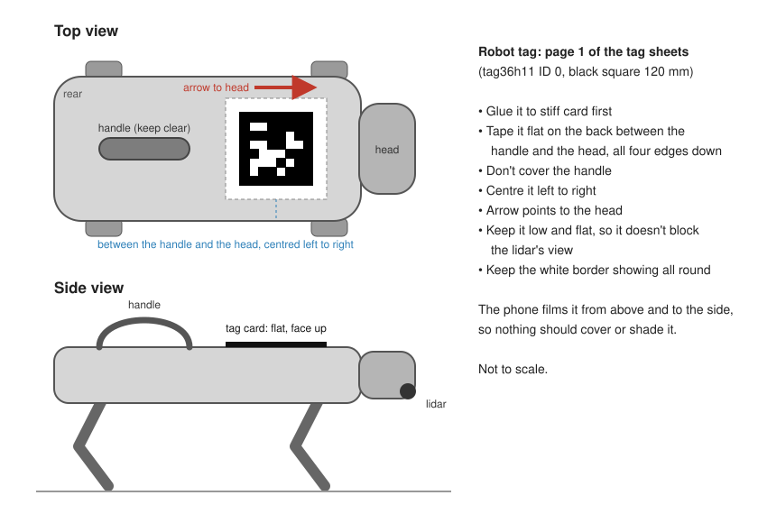

# Go2 setup on the robot computer

Follow these steps on the Ubuntu computer wired to the robot. They end with a read-only check that sends no commands to the robot.

**Don't run other scripts yet.** Unitree's examples can move the robot as soon as you give them a network interface. `stand_test.py` only works with the simulator, so it can't reach the robot. `run_policy.py` only reaches the robot if you pass `--robot`, and [Run a policy](#run-a-policy) covers when to do that. `check_lidar.py`, `lidar_map.py` and `push_box_map.py` are also read-only, and [Check the lidar](#check-the-lidar) covers them. So is `check_odom.py`, which [Check the odometry](#check-the-odometry) covers. `phone_camera.py` never talks to the robot, and [Film with a phone](#film-with-a-phone) covers it. `tag_tracker.py` and `make_tag_sheets.py` only read videos and write files, and [Measure the walk with AprilTags](#measure-the-walk-with-apriltags) covers them. `watch.py` is read-only too, and [Diagnose a failed transfer](#diagnose-a-failed-transfer) covers it with `diagnose.py`. So is `record_walk.py record`, which [Record a sport-mode walk](#record-a-sport-mode-walk) covers. `sysid.py passive` is read-only, but `sysid.py hang` and `sysid.py stand` move the robot, and [Measure the robot for the simulator](#measure-the-robot-for-the-simulator) covers them. `calibrate.py` runs these and the input check in order before a session, and says before each step whether it moves the robot. [ROBOT_SESSION.md](ROBOT_SESSION.md) covers it.

## 1. Install

You need `git`, `conda`, and `sudo` rights for the network step. Check the first two with:

```bash
git --version
conda --version
```

Then install the SDK:

```bash
git clone -b go2-dev https://github.com/daniel-campa/unitree_sdk2_python.git
cd unitree_sdk2_python
go2/setup_env.sh
```

It should finish with `SDK imports OK`.

To get later changes, run `git pull` in this folder.

## 2. Prepare the robot

1. Put the robot on the floor or a stand, with clear space around it.
2. Turn it on and let it finish starting up. Don't change its mode.
3. Connect it to this computer with an Ethernet cable.

## 3. Set up the network

Find the Ethernet port's name, which usually starts with `en`:

```bash
ip -br link
```

The scripts default to `enx80691a8d7c72`. If yours is different, use its name below and pass it to each script. Set it here, then give the port an address on the robot's network:

```bash
IFACE=enx80691a8d7c72
sudo ip addr add 192.168.123.51/24 dev "$IFACE"
sudo ip link set "$IFACE" up
```

This adds no default route, so Wi-Fi and internet keep working. The address lasts until the computer reboots or the cable is reconnected, so repeat this step if it disappears.

Optional: test the link. Unitree's documented address for the Go2 is usually `192.168.123.161`, but this hasn't been tried on your robot, so a failed ping alone doesn't prove a problem.

```bash
ping -c 3 192.168.123.161
```

## 4. Check the connection

```bash
conda activate go2
export PYTHONNOUSERSITE=1
python go2/check_connection.py "$IFACE"
```

**A PASS only means valid messages arrived.** Also check that:

- Battery, motor temperatures and foot force are non-zero and sensible.
- Joint angles match the robot's pose.
- `rt/sportmodestate` messages are arriving, since sport mode should still be on.

Save the output to share it:

```bash
python go2/check_connection.py "$IFACE" | tee connection_check.txt
```

## If something fails

| Message | What to try |
|---|---|
| `no network interface called ...` | Use a name from the list it prints. |
| `... is down` | Check the cable and that the robot is on, then repeat step 3. |
| `has no IPv4 address` | Repeat step 3. |
| `channel factory init error` | CycloneDDS couldn't start, and the line above the error may say why. It writes a log to `/tmp/cdds-<uid>.LOG`, so if that can't be opened, delete the file. |
| `has no 192.168.123.x address` | Repeat step 3. If the address keeps disappearing, the network manager is probably removing it, so see below. |
| `no rt/lowstate received` | Check the robot's power and the cable, then run `ip addr show "$IFACE"` to confirm the address. A firewall can also block this, so check `sudo ufw status`. |
| `conda: command not found` | Install Miniconda, or run `source ~/miniconda3/etc/profile.d/conda.sh` if it's already installed. |

To make the address stay with NetworkManager, using a new connection called `go2`:

```bash
sudo nmcli con add type ethernet ifname "$IFACE" con-name go2 ipv4.method manual ipv4.addresses 192.168.123.51/24 ipv6.method disabled
sudo nmcli con up go2
```

## Optional: test without the robot

This needs a display-free run of the simulator in one terminal and the test in another. It can't reach the robot.

```bash
go2/setup_env.sh --with-sim

# Terminal 1
conda activate go2; export PYTHONNOUSERSITE=1
python go2/sim_headless.py

# Terminal 2
conda activate go2; export PYTHONNOUSERSITE=1
python go2/stand_test.py
```

The test should end with `PASS`. Press Ctrl-C in terminal 1 to stop the simulator.

## Check the lidar

`check_lidar.py` shows whether the lidar can supply the seven terrain beams that the `platform_curve` policies steer on. It only subscribes to topics, so it can't move the robot or switch the lidar on or off.

**This hasn't been tried on a real robot.** It has only run against a fake publisher. Its topic names come from third-party docs, and the frame names and how the height map marks unknown cells aren't documented, so it may need changes after the first run.

Do sections 1-4 first, so `$IFACE` is set. Keep the robot still while it runs:

```bash
python go2/check_lidar.py "$IFACE" | tee lidar_check.txt
```

**A PASS only means data reached all seven beam locations.** It doesn't show the readings are right, so do these runs, saving each to its own file. Distances are from the middle of the body.

1. **Flat floor, standing.** Every beam should read about the same height, and the three differences should be near 0. `spread` should be small compared with the 0.30 m an edge produces.
2. **Low box on the left.** Stand a box about 10 cm high in front of the robot, covering 0.35-0.55 m ahead and 0.05-0.45 m left of the centreline. The three differences should read about +0.10. A negative value means left and right are swapped.
3. **Raised edge, if you have one.** Stand the robot on a stable raised surface with the drop close on one side, and keep someone next to it. A lidar can't see the floor just past a raised edge, so those beams may show `--` instead of the -0.57 they read in simulation. A `FAIL` here is a useful result, so note which beams have data.
4. **Sport mode off.** Run stage 2 of [Test on the robot](#test-on-the-robot) with `--leave-sport-off`, so sport mode stays off afterward. Run the check again then, to see which topics still publish. The robot is lying down by that point, so only the rates and `valid %` mean anything.

| Message | What it means |
|---|---|
| `no lidar topics received` | The lidar may be off, or this firmware may use other topic names. Don't try `example/go2/high_level/go2_utlidar_switch.py` as a check, because as written it switches the lidar off. |
| `frame ... isn't handled` | The script can't place that topic's points relative to the body. This doesn't matter if another source passes. Otherwise, the frame needs adding to the script. |
| `needs the robot's pose` | That topic's data needs `rt/utlidar/robot_odom`, which isn't arriving. |
| `no source covered all seven beams` | Check `valid %`. A low value on every beam suggests sparse data, and a value near 0 on some beams suggests the lidar can't see them. `--ahead` tries the beams at another distance, to find where coverage starts. |

### See the height map

`lidar_map.py` draws the height map live, with the robot and the seven beams on top. It's also read-only. Close the window to stop it, or use `--save` to get one picture without needing a display:

```bash
python go2/lidar_map.py "$IFACE"
python go2/lidar_map.py "$IFACE" --save lidar_map.png
```

- **Colours:** these show height relative to the base, on a fixed scale from -0.7 to +0.1 m. Grey cells are unknown, and anything above +0.1 m shows as the top colour.
- **Robot:** the red dot is the base, and the arrow points to the middle beam. Beam `0` should be on the robot's left.
- **Terminal:** it prints the most repeated values in the first map. A value repeated across many cells is probably the marker for unknown cells. If that marker is smaller than 100 m, the script draws it as a real height.

### See push_box_turn's crate beams

`push_box_map.py` is `lidar_map.py` for the `push_box_turn` task. Instead of the seven terrain beams it draws that task's seven crate beams. It's also read-only.

**This hasn't been tried on a real robot.** It has only run against the simulated lidar.

```bash
python go2/push_box_map.py "$IFACE"
python go2/push_box_map.py "$IFACE" --save crate.png
```

In S-M-ICRL each beam is a 10° fan of 5 near-level rays, with fans at bearings +30° to −30° (beam `0` on the left). Each ray starts 0.10 m above the base and drops just enough to meet open floor 10 m out. A beam reads `1 - d/4` for the nearest hit `d` in its fan, or 0 if nothing is within 4 m, and `object_dist` is the nearest hit over all the beams. This script marches each ray across the height map, and a ray hits the first cell that is higher than it. It uses S-M-ICRL's crate (0.45 m tall, 0.60 m wide), which sits 2 m from the robot when an episode starts. With the crate dead ahead, beams 2-4 should read about 0.56 and `object_dist` about 1.78 m.

- **Picture:** blue rays hit something and end at the hit. Grey rays saw nothing within 4 m. The labels at the ends give each beam's reading.
- **Terminal:** about once a second it prints `env[0:7]`, `object_dist` and `known %`, which is the share of each beam's worst ray that crossed known cells before its hit (or its whole 4 m if it didn't hit). Unknown cells count as empty, so a beam with a low `known %` may be missing the crate rather than seeing open floor. Use `tee` to keep a record.
- **Floor:** the ray heights come from the base's height above the floor. The script takes the floor as the median of known cells within 1 m of the base and prints the result. If that looks wrong, pass `--base-height` (in m).
- **Robot's own body:** if the map shows the robot itself, the beams will read close to 1 with nothing in front. `--skip 0.35` ignores the first 0.35 m of every ray.
- **Map size:** the beams reach 4 m, so a map smaller than that cuts them short. Beyond its edge they read as empty, and `known %` drops.

Runs to do, with the robot standing still and the crate (or a box of about the same size) 2 m away:

1. **Crate dead ahead.** Beams 2-4 should light, about 0.56.
2. **Crate 30° left, then 30° right.** Beams 0-1, then 5-6. If the wrong side lights, left and right are swapped.
3. **Nothing in front.** Every beam should read 0. A low box (10 cm) shouldn't light anything, because the rays pass above it.
4. **Move the crate in.** At 1 m (face 0.775 m from the base) the lit beams should read about 0.8.

Each hit is only placed to within a map cell, so a fan that only grazes the edge of the crate can light here when it wouldn't in S-M-ICRL. In the simulator, with the crate 15° left, beam 0 reads 0.54 here and 0 in S-M-ICRL, because the crate's corner is 0.4° inside that fan's outer ray.

### Try it in the simulator

To see what the report looks like without a robot, `sim_headless.py --lidar` publishes simulated lidar topics. `--box` adds the box from run 2 above. Run each command in its own terminal:

```bash
python go2/sim_headless.py --lidar --box
python go2/stand_test.py --hold 15
python go2/check_lidar.py lo --domain 1 --seconds 5
```

For `push_box_map.py`, use `--crate DEG` instead of `--box`. It puts a fixed crate 2 m away at that bearing (+ is left):

```bash
python go2/sim_headless.py --flat --lidar --crate 15
python go2/stand_test.py --hold 15
python go2/push_box_map.py lo --domain 1
```

Start the check about 3 s after `stand_test.py`, once the robot is standing. Without `stand_test.py` the robot lies on the floor, so the heights are smaller, but the differences stay the same.

**A PASS here says nothing about the real robot.** The simulated data has no noise, and its frames, scan pattern and lidar mount are assumptions. `rt/sportmodestate` always publishes in the simulator, so ignore the sport mode line too. The simulated lidar also slows the simulator by about 25%, so leave it off when testing policies.

## Run a policy

`run_policy.py` runs a policy from S-M-ICRL, or plays back a recorded joint trajectory ([Play back a joint trajectory](#play-back-a-joint-trajectory)). It uses the simulator unless you pass `--robot`.

It takes all three of S-M-ICRL's policy forms: a file that ends with `robot.simulate_rollout(policy)`, and the classifier forms `robot.simulate_classifier(matrices, selector)` (the selector picks one matrix each call) and `robot.simulate_weighted(matrices, weigher)` (the weigher blends them). The classifier forms are checked and run as S-M-ICRL runs them, and everything below applies to them the same way. A weigher that uses random numbers is refused, like any policy that isn't repeatable.

`policies/walk_tmnxt_iter17.py` is an unchanged copy of `iter_17/code.py` from the run `walk_2026-10-27_17-37-32_TMNXT`. The script's default rate and gains (5 Hz, kp 80, kd 4) come from that run. Keep them for this policy, because the rate sets its gait and lower gains make it walk much less far. A policy from another run needs the values from that run's `config.json`.

The robot can't measure body velocity and height (`robot_state[30:34]`), or the env vector's ground probes. By default `state_estimator.py` estimates them every control cycle from the leg kinematics, IMU and foot force sensors:

- Velocity and height go into `robot_state[30:34]`. In S-M-ICRL with robot-like noise they were within 1.5 cm/s and 3 mm of the truth on the walk. They haven't been tried on the robot yet, so `calibrate.py` checks them against sport mode's estimate first.
- The probes are minus the estimated height, which is what S-M-ICRL gives on a flat floor. As in S-M-ICRL, the env vector is rebuilt at 25 Hz (`--env-hz`) and multiplied by the policy's latest matrix every cycle. Clearance and obstacle distance are always "open", so **the robot can't sense steps or obstacles**.
- `--fill-unmeasured` feeds velocity 0 and a base height of 0.27 m instead (`--fill-unmeasured 0.25` sets another height), as if the body never moved, so test that in simulation first. `--no-estimate` feeds nothing and refuses a policy whose output depends on velocity or height. It checks 200 calls of the policy, so it also catches a policy that only reads them after its start-up phase.

With `--robot` it needs a calibration from `calibrate.py` that passed, for this robot (see [ROBOT_SESSION.md](ROBOT_SESSION.md)). It refuses without one, and `--no-calibration` overrides that. A policy may keep state between calls. `--check` only loads and checks the policy, without connecting to anything. S-M-ICRL's real-robot loop uses it before each run.

### Test in the simulator

Install the simulator with `go2/setup_env.sh --with-sim`, then:

```bash
# Terminal 1
conda activate go2; export PYTHONNOUSERSITE=1
python go2/sim_headless.py --flat --dt 0.002

# Terminal 2
conda activate go2; export PYTHONNOUSERSITE=1
python go2/run_policy.py go2/policies/walk_tmnxt_iter17.py --seconds 10
```

Terminal 2 should end with `Result: finished`, and `base_x` in terminal 1 should reach about 6-7 m.

If a calf speed fault stops the walk, check two things. The simulator needs `--dt 0.002`, because at its default 5 ms the calves oscillate. It also has to keep up with real time, so don't run other heavy jobs alongside it.

To watch it, add `--viewer` to terminal 1's command. A window follows the robot, and closing it stops the simulator. Without a display, add `--video OUT.mp4` instead. The simulator keeps the robot's pose 30 times a second and renders the video when it stops (Ctrl-C, SIGTERM or `--duration`), so recording doesn't slow it down. Rendering takes a few seconds after it stops. `--odom` publishes the simulator's true base pose as `rt/utlidar/robot_odom` at 50 Hz, so `run_policy.py`'s log records where the robot went. It's much cheaper than `--lidar`, which also publishes it but at 10 Hz and slowed by its raycasts.

**The window hasn't been opened on this computer yet**, because there was no display to test it on. Without a working GPU driver it's drawn in software, at roughly 20 frames/s with shadows and reflections off (as it starts) and about 5 frames/s with them on. It's held to 2 CPU threads, so that it can't take time from `run_policy.py`.

A slow simulator is the main thing to watch for. `run_policy.py` keeps to real time, so if the simulator falls behind, the policy acts too often for the physics and every motion goes wrong. With `apt` and `conda` installs running, the simulator here ran at about 35% of real time, and `walk_tmnxt_iter17.py` went 0.15 m in 10 s instead of 6-7 m. Every second, terminal 1 prints the simulated time `t`. It should go up by about 1 each time. To help it keep up, the simulator publishes `rt/lowstate` and `rt/sportmodestate` at 200 Hz, not the robot's 500 Hz.

S-M-ICRL's real-robot loop can run each policy here first, in the window, for you to approve before the robot (`real_robot.preview`, see its `real_robot.md`). It starts the simulator itself, with `--flat --dt 0.002 --odom` and either `--viewer` or, if the terminal has no display, `--video` into the iteration's folder. It warns when the simulator ran below 90% of real time.

### Test on the robot

**None of this has been tried on a real robot yet.** Do these stages in order, and stop if anything looks or sounds wrong. You need sections 1-4 above done, `$IFACE` set, the remote, and a harness or stand that can hold the robot. Stage 1 needs nothing else. Run `calibrate.py` ([ROBOT_SESSION.md](ROBOT_SESSION.md) Part A) before stage 2, because the stages that move the robot refuse without a passing calibration.

The script asks you to type `yes` and press B on the remote, then lies the robot down and turns sport mode off. It stands up and waits for you to press Enter before walking.

**1. Read-only.** This publishes nothing, so it can't move the robot:

```bash
python go2/run_policy.py go2/policies/walk_tmnxt_iter17.py --robot "$IFACE" --dry-run --seconds 30
```

Put the robot in damping mode with the remote or app so the legs move by hand, then check that:

- Lowering the right side raises `roll`, and lowering the nose raises `pitch`.
- Each thigh value rises as that leg swings backward, and each calf value gets more negative as the knee folds.
- `B button` shows `pressed` while you hold B.

**2. Hanging, feet clear of the ground.** Run `--seconds 0` first, which only stands up and lies down, then `--seconds 5`:

```bash
python go2/run_policy.py go2/policies/walk_tmnxt_iter17.py --robot "$IFACE" --seconds 0
python go2/run_policy.py go2/policies/walk_tmnxt_iter17.py --robot "$IFACE" --seconds 5
```

In simulation the target changes on nearly every policy call, thighs stay within 0.65-1.2 rad, and calves within -2.05 to -1.7 rad. A buzzing or fast shaking leg isn't expected, so stop if you see one.

While it's hanging, also test each way of stopping:

- Press B during a run.
- Press Ctrl-C during a run.
- Find out what the motors do when commands stop, by running `pkill -9 -f run_policy.py` in a second terminal during a run. The script can't damp the motors after this, so keep the robot held and clear of people. You'll need to restart the robot afterward.

**3. On the floor, in a slack harness.** Run `--seconds 0`, then `--seconds 2`, and build up through 3 and 5 to 10:

```bash
python go2/run_policy.py go2/policies/walk_tmnxt_iter17.py --robot "$IFACE" --seconds 2
```

- Clear a flat lane of about 8 x 4 m. Feet only lift about 2-3.5 cm, so remove cables and anything else above 1 cm.
- Expect about 0.6 m/s and some sideways drift, because nothing corrects its heading. Drift reached about 1.6 m in simulation.
- Keep someone ready to press B, and watch `hottest` and `current` in the output.

### Crab (sideways walk)

`policies/crab_biahd_iter35.py` is an unchanged copy of `iter_35/code.py` from the run `crab_2026-10-27_10-10-07_BIAHD`. It trots to its left in a 1.4 s cycle. It corrects its heading with the IMU, and corrects forward drift and body height with velocity and height, which come from the estimate (the default). It needs its own rate:

```bash
python go2/run_policy.py go2/policies/crab_biahd_iter35.py --policy-hz 10 --torque-fraction 0.8 --seconds 17
```

With the estimate, in S-M-ICRL with robot-like sensor noise, it went 2.36 m sideways against 2.53 m with the true values. The crab slides sideways in simulation, so its sideways speed read about 0.06 m/s low. Add `--fill-unmeasured` to run it on constants instead, as the figures below were.

Keep kp 80 and kd 4 (the defaults). The policy walks for 15.4 s after a 0.4 s settle, then holds its pose, so `--seconds 17` covers a whole run.

What simulation shows, with velocity and height fixed:

- **S-M-ICRL's simulator:** 4.2 m sideways in 17 s, against 4.4 m with the real values. Softer gains break it: at kp 60 / kd 5 it drifted 1.5 m forward and turned 1.1 rad, because the forward-drift correction that would catch this needs velocity.
- **`sim_headless.py` (Unitree's model):** about 2.6 m sideways and 0.7-0.9 m forward, turning right by 0.55 rad (torque fraction 1.0) to 0.8 rad (0.8). At the default 0.6 the turn grew to 1.2 rad, and the run stopped at 13 s with a hip at its joint limit. Roll peaked at 0.47 rad in every run, close to the 0.5 rad tilt cutoff, so a tilt fault on the robot wouldn't be a surprise.

On the robot, follow the same stages as [Test on the robot](#test-on-the-robot), with the crab command in place of the walk one. For stage 3, clear about 4 m to the robot's left and 2 m in front of it.

### Play back a joint trajectory

`--trajectory FILE --rate HZ` plays a recorded list of joint angles instead of running a policy. Give it in place of the policy file:

```bash
python go2/run_policy.py --trajectory ../S-M-ICRL/class_results/joint_trajectories.txt --rate 33 --check
python go2/run_policy.py --trajectory ../S-M-ICRL/class_results/joint_trajectories.txt --rate 33
```

The file's first line is a `#` header naming the 12 joints in its column order, such as `#FL_hip_joint FL_thigh_joint ... RR_calf_joint`. The script reorders the columns to the SDK's FR, FL, RR, RL, so any order works as long as the header matches the columns. Each further line is one sample, in radians. `--rate` is how many samples there are per second. There's no default, because the wrong rate plays the motion too fast or too slow.

The sequence is the same as for a policy: stand up and wait for Enter. Then it ramps for 1 s to the first sample, plays the samples, interpolating between them at 500 Hz, returns home and lies down. It plays the file once, and `--seconds` can cut it short. `--check` and `--dry-run` work as for a policy. `--check` also prints the length, how far the first sample is from home, and the fastest commanded joint speed. The script refuses a file with a sample at a joint limit, or a step between samples that exceeds the speed fault at that rate. The log's `target` column holds the interpolated angles.

**It's open loop.** Nothing reacts to tilt, slips or pushes except the faults in [What stops a run](#what-stops-a-run). The angles are tracked through the same PD gains (`--kp`, `--kd`, default 80 and 4) and torque cap as a policy. Use gains close to those the trajectory was recorded with.

In `sim_headless.py` (`--flat --dt 0.002`), `joint_trajectories.txt` (157 samples, 4.7 s at 33 Hz) ended `Result: finished`. It went about 1.0 m forward, with tilt peaking at 0.17 rad. With kp 80, the joints lagged the targets by up to 0.32 rad. **It hasn't been played on the robot yet.** Follow the stages in [Test on the robot](#test-on-the-robot), with the trajectory command in place of the walk one.

### What stops a run

These go straight to damping, which lets the robot sink to the ground:

- B on the remote, or Ctrl-C
- Tilt above 0.5 rad
- Joint speed above 25 rad/s (hip, thigh) or 14 rad/s (calf)
- A motor at 70 °C
- A joint at its limit
- The newest robot state is more than 0.1 s old. The age is measured against the robot's own clock (the state's `tick`), so it also catches states that arrived on time but waited in a queue: on 2026-11-19 a walk ran on states 0.3–0.7 s old while the arrival time said 2 ms. The cause was that DDS called a Python handler for every state on its own receive thread, and that thread waited for the interpreter while the control loop kept it busy, so states queued up behind it. `run_policy.py`, `sysid.py`'s control tests and `watch.py` now collect the newest states themselves (`ChannelSubscriber.InitPolled`) instead. Against a stand-in robot on the loopback interface, with the control loop loaded until it ran at 200 Hz, the old way fell 1 s behind within 3 s and the new way stayed 1-2 ms behind. It hasn't been retested on the robot yet. If the fault happens, keep the log and note the message.
- The control loop stalling for 0.2 s, or the policy failing
- The terminal or SSH session closing, or SIGTERM. Its output then goes to `go2/logs/hangup.log`. A closed terminal never counts as pressing Enter.

**Nothing protects the robot if the script is killed, the computer fails, or the cable comes out.** Stage 2 shows you what happens then.

**Over SSH, run everything in tmux on the robot computer** (`tmux new -s go2`, `Ctrl-b %` for a second pane, `tmux attach -t go2` to get back after a dropped connection). Then a dropped connection doesn't stop anything. Without tmux, it stops the run and damps the motors, as above. `sysid.py`, `calibrate.py` and `watch.py` handle a closed terminal the same way.

The script aims to keep torque within 80% of the limits (`--torque-fraction`). Peaks can go above that. At the old 60% default the thigh reached about 21 N·m in simulation, against a 14 N·m target and a 23.7 N·m limit. On the robot, 60% held the thighs back for about half of each walk, so they often didn't finish a swing before the next policy call and the gait staggered. The 80% default hasn't been tried in simulation or on the robot yet. Expect thigh peaks at the 23.7 N·m limit, where the motor saturates.

Each run saves its data to `go2/logs/<time>.npz`, including `rt/utlidar/robot_odom` when it publishes. After a run that finishes, `run_policy.py` switches sport mode back on, to the mode the robot was in (`--sport-mode` names it if the robot was already in low-level mode). The robot may move when it does. After a stop or a fault it asks first; press Enter to switch it on, or type `n`. `--leave-sport-off` skips this. If it reports that sport mode didn't come back, use the app or restart the robot. This hasn't been tried on the robot yet. `sysid.py` and `calibrate.py` still leave sport mode off.

## Measure the robot for the simulator

`sysid.py` runs the same tests on the robot, on `sim_headless.py`, and in S-M-ICRL's physics (`--smicrl`), then lines up the results. Use it when a policy that works in simulation fails on the robot. It measures command-to-response latency, torque scale, tracking gain and phase from 0.5 to 4 Hz, Coulomb and viscous friction per joint type, standing sag and holding torque, state rate and sensor noise.

S-M-ICRL's training sim differs from the robot in ways these tests show. Its PD law adds gravity compensation (`qfrc_bias`) to every joint and applies each target with no delay. Its joints use `frictionloss` 0.2 and `damping` 0.1. The robot's motors do none of this, so `compare` shows each difference and the change that would close it.

`calibrate.py` runs `passive`, `hang` and `stand` as part of its steps. To run them on their own, do these in order, after section 4 and stage 1 of [Test on the robot](#test-on-the-robot):

```bash
# 1. Read-only, about 10 s. Robot lying down or standing still in sport mode.
python go2/sysid.py passive --robot "$IFACE"

# 2. MOVES THE LEGS, about 2.5 minutes. Hanging in a harness, all four feet clear.
python go2/sysid.py hang --robot "$IFACE"

# 3. MOVES THE ROBOT, about 20 s. On a flat floor.
python go2/sysid.py stand --robot "$IFACE"
```

`hang` asks you to type `hanging`, and like `run_policy.py` it needs B pressed, releases sport mode, stands up and waits for Enter. Steps are 0.1 rad, sines 0.1 rad and ramps at most 0.25 rad from the home pose. `--scale 0.5` halves them, and `--groups thigh` tests one joint type. The faults in [What stops a run](#what-stops-a-run) apply.

Then run the same tests in S-M-ICRL's physics, which takes seconds and doesn't need a simulator running, and compare, robot first:

```bash
python go2/sysid.py hang --smicrl ../S-MICRL/Robots/go2/scene.xml
python go2/sysid.py stand --smicrl ../S-MICRL/Robots/go2/scene.xml
python go2/sysid.py compare go2/logs/sysid/*_hang_robot.json go2/logs/sysid/*_hang_smicrl.json
```

Pass the scene your S-M-ICRL config's `xml_path` names. `--no-gravity-comp` runs it without S-M-ICRL's gravity compensation. In `sim_headless.py`, start the simulator with `--flat --dt 0.002 --hang` for `hang` (the body is welded in the air) and without `--hang` for `stand`, then run the same commands without `--robot`.

`analyze` reads a `run_policy.py` log from a real walk and reports peak and 99th-percentile torque per joint type, the peak torque in each speed band, how often the torque cap moved a target, and how far and how late the joints followed their targets:

```bash
python go2/sysid.py analyze go2/logs/<time>.npz
```

Each test saves `go2/logs/sysid/<time>_<test>_<robot|sim|smicrl>.npz` and its results as `.json` next to it.

## Diagnose a failed transfer

When a policy walks in S-M-ICRL but not on the robot, record the run from a second terminal and compare it with the same policy in S-M-ICRL.

1. Make a reference once per policy. Run it in S-M-ICRL's Python environment, with the task config the policy was trained with. It runs the policy file through S-M-ICRL's own trial code, including its latency and frequencies:

```bash
python go2/diagnose.py reference go2/policies/POLICY.py --smicrl ../S-MICRL --config func_config/go2/walk/walk.yaml
```

2. Start the watcher, then run the policy as usual, at the config's `policy_hz`. The watcher is read-only. It prints the command-to-torque latency measured during the walk, saturation, tilt and timing every second, and saves when the commands stop:

```bash
nice -n 10 python go2/watch.py --robot "$IFACE"                                   # terminal 1
python go2/run_policy.py go2/policies/POLICY.py --robot "$IFACE" --policy-hz 10   # terminal 2
```

3. Compare:

```bash
python go2/diagnose.py report go2/logs/<time>.npz --watch go2/logs/watch/<time>.npz --reference go2/logs/reference/POLICY.npz
```

The report prints the S-M-ICRL sweep's columns (x, y, vx, yaw, minh, fell, sat%, sw/call) for the reference and the robot. It also shows how much of each commanded joint move was done by the next policy call (`reach`), torque saturation and cap clipping, call timing, foot contacts, and the policy inputs the robot fed that the reference never saw. It ends with a list of likely causes and saves everything as `<log>.diagnosis.json`. sw/call, reach and the input checks need a run_policy.py log made after per-call logging was added.

`calibrate.py` does this as one of its steps. To check that each policy input means on the robot what it means in S-M-ICRL on its own, record the robot walking in sport mode with the remote, then check the recording:

```bash
nice -n 10 python go2/watch.py --robot "$IFACE" --seconds 120   # walk it around with the remote meanwhile
python go2/diagnose.py inputs go2/logs/watch/<time>.npz
```

It compares each of the 37 inputs with a second source: the joint angles' rate, the IMU's own rpy, the quaternion's rate, gravity in the accelerometer, Unitree's foot positions, and sport mode's velocity and height for the `--estimate` values. [ROBOT_SESSION.md](ROBOT_SESSION.md) has the full session plan and a table of what each input is on the robot.

## Record a sport-mode walk

`record_walk.py` records the robot while you walk it in sport mode, and rebuilds the motion afterwards: as a video of the Go2 model going through it, as a joint file that `run_policy.py --trajectory` can play, and as a CSV. Recording is read-only. It only subscribes to topics, so the robot moves only when you move it, with the remote or the app.

**The recorder hasn't been tried on the robot yet.** It has recorded a stand-in robot on the loopback interface that published the same three topics. What it rebuilt matched what the stand-in sent: joint angles within 0.2 mrad and the body's path within 0.2 mm, also while the recorder's computer was kept busy. `info`, `replay` and `export` have been run on a real sport-mode walk, the calibration's remote walk of 2026-11-19 (`go2/logs/calibration/<time>/input_walk.npz`). That is a `watch.py` recording, which they also read.

### 1. Record

Do sections 1-4 first, so `$IFACE` is set. With the robot standing in sport mode:

```bash
python go2/record_walk.py record --robot "$IFACE" --note "slow walk forward, 2 m"
```

Walk the robot, then press Ctrl-C. It saves `go2/logs/walks/<time>.npz` and prints what's in it. A closed terminal saves it too. It stops by itself after 10 minutes (`--seconds`), because the recording is held in memory until it's saved, at about 40 MB a minute.

Each second it prints the message rates, how far the robot is from where it started, its speed, and the remote's sticks. On 2026-11-19 the robot sent `state` at 500 Hz and `sport` at 300 Hz.

| It records | From |
|---|---|
| Joint angles, speeds, torques and temperatures, the IMU, foot force, battery, and the remote's sticks and buttons | `rt/lowstate` |
| Sport mode's body position, velocity, yaw rate, attitude, mode and gait | `rt/sportmodestate` |
| The joint targets and gains sport mode sends its motors | `rt/lowcmd` |

On 2026-11-19, sport mode's commands were plain position targets with kp 40 and kd 1, no feed-forward torque, changing 50 times a second.

Each message is timed by a clock on the robot (the state's `tick`, sport mode's stamp, the time DDS sent a command), not by when this computer read it. So a busy computer doesn't smear the recording.

| Message | What it means |
|---|---|
| `no rt/sportmodestate` | Sport mode is off, so the body's position isn't recorded. The joints and IMU still are. |
| `... ms behind the robot` | This computer is busy. The recording is still right, but past 8 s behind, messages are lost. Close other programs. |
| `No rt/lowstate ...` | See [If something fails](#if-something-fails). |

### 2. See what's in it

```bash
python go2/record_walk.py info go2/logs/walks/<time>.npz
```

It prints the rates, how many states were lost, and a table of the stretches where the robot was moving: when, how far forward and left, how much it turned. Those times go into `--start` and `--end` below.

### 3. Rebuild the motion

```bash
python go2/record_walk.py replay go2/logs/walks/<time>.npz --start 12 --end 20 --video walk.mp4
python go2/record_walk.py export go2/logs/walks/<time>.npz --start 12 --end 20
```

These don't need the SDK, only numpy, so they also run on another computer. `replay` also needs MuJoCo, OpenCV and a Go2 model: `go2/setup_env.sh --with-sim` installs them, and `--scene` points it at another `scene.xml`, such as S-M-ICRL's `Robots/go2/scene.xml`.

How the motion is rebuilt:

- **Frame:** the start of the stretch is the origin, facing +x, with y to the left.
- **Body position and attitude:** sport mode's own. Its yaw is used, not the raw IMU's, because its position goes with it: on 2026-11-19 the two were 0.15 rad apart and drifting.
- **Height:** Unitree doesn't say which point of the body its height is for, so one shift for the whole stretch stands the lowest foot on the floor. On 2026-11-19 it was +29 mm, and the feet then stayed within 3 mm rms of the floor.
- **Joints:** from `rt/lowstate`, interpolated onto an even clock. The output says how much of a stretch falls in holes where messages were lost.
- **Without sport mode** (a `watch.py` recording of a policy run, for example): the body's position is worked out from the legs and IMU by `state_estimator.py`. On the 2026-11-19 walk that read 9-13% longer than sport mode's own position.

`replay` poses the model as recorded and films it. Nothing is simulated, so it shows what the robot did, not what a simulator would do. `--speed 0.25` gives slow motion. **It has only been rendered on a Mac**, not on the robot computer, where it uses the same offscreen rendering as `sim_headless.py --video`.

`export` writes two files next to the recording:

- `<recording>_trajectory.txt`: the joint angles at `--rate` (default 50 Hz), in the format [Play back a joint trajectory](#play-back-a-joint-trajectory) takes. `--source commanded` writes the targets sport mode sent instead of the angles the joints reached. It runs `run_policy.py`'s own check on the file and prints the command that plays it.
- `<recording>_motion.csv`: one row per sample with `t`, the base's `x y z` and `qw qx qy qz`, `yaw`, each joint's angle (`FR_hip_q`, ...) and speed (`_dq`), the velocity along the body's own axes, `yaw_rate`, the four foot forces, sport mode's targets (`_cmd`) and the sticks.

**A playback is open loop.** Sport mode balances with feedback and a playback doesn't, so it won't repeat the walk exactly. In plain MuJoCo physics with S-M-ICRL's Go2 model, three stretches of the 2026-11-19 walk were played the way `run_policy.py` plays a file:

| Stretch | Recorded | Measured angles, kp 80, kd 4 | Commanded targets, kp 40, kd 1 |
|---|---|---|---|
| Fast forward, 2.6 s | 1.59 m | 1.42 m, upright | fell at 1.5 s |
| Slow forward, 3.9 s | 1.13 m | 0.75 m, upright | 1.42 m, upright |
| Sideways, 2.3 s | 0.88 m | 0.31 m, upright | 1.03 m, upright |

**No exported file has been played through `run_policy.py` yet**, in `sim_headless.py` or on the robot. Sport mode's targets jump by about 0.14 rad every 20 ms. `run_policy.py` refuses a file that asks for more speed than its speed fault allows, so it refuses some commanded stretches, and `export` says when. On the robot, follow the stages in [Test on the robot](#test-on-the-robot) with the playback command in place of the walk one.

## Check the odometry

`check_odom.py` tests whether the robot's own position estimate is good enough to score S-M-ICRL's walk reward on the real robot. It only subscribes to topics. The robot moves only when you move it: with the remote, with `run_policy.py` in another terminal, or by hand.

Do this once [Test on the robot](#test-on-the-robot) works. You need two terminals, the remote, floor tape, a tape measure, and the clear lane from stage 3. Then run:

```bash
python go2/check_odom.py record "$IFACE"
```

It takes you through five steps, waiting for Enter between them:

| Step | What you do | What it shows |
|---|---|---|
| 1. Still, sport mode on | Leave the robot standing as it is after start-up, and stand back for 20 s | the noise with sport mode running |
| 2. Remote walk (optional) | Walk it about 1 m forward with the remote | accuracy with sport mode's own estimator running |
| 3. Policy walk | Run `run_policy.py --robot` in the other terminal | whether each topic survives sport mode being released and follows a low-level walk |
| 4. Moved by hand (optional) | Slide or carry it about 1 m forward, holding the body | whether each topic follows the robot when no legs are stepping |
| 5. Still, sport mode off | Stand back for 20 s | the noise after the release |

- **Measuring:** before each move step, lay tape along the robot's heading and mark the floor under the middle of its body. Afterwards, type how far the middle of its body moved along the tape, and to the left of it (right is negative). Leave a blank for anything you didn't measure.
- **Still steps:** the lidar sees people, so stand well back. `--still-seconds` changes their length.
- **Stopping:** Ctrl-C in this terminal only stops the recording, not the robot. Each step is saved as it finishes.
- **Timing:** recording runs alongside `run_policy.py` on the same computer. Check that its `worst loop overrun` stays like your earlier runs.

When it finishes, it prints a report and saves the recording to `go2/logs/odom_<time>.npz`, with a plot next to it. To see the report again, run `python go2/check_odom.py analyze go2/logs/odom_<time>.npz`. `--free` skips the steps and records until Ctrl-C.

### Reading the report

It checks four topics. `rt/utlidar/robot_odom` and `rt/sportmodestate` published on the robot with sport mode on. `rt/utlidar/robot_pose` and `rt/odommodestate` are guesses, and `no messages` for them may only mean that their message type is different.

1. **Publishing after sport mode was released.** `rt/sportmodestate` stops when sport mode is released, so that's taken as the release time. `STOPPED` means a topic can't be used under low-level control. A `jumped` line just after the release suggests that the estimate reset.
2. **Following the robot.** This shows how far each topic says the robot moved in each move step, next to your measurements and the IMU's yaw. `DIDN'T MOVE` means the topic stayed put while the legs were moving.
3. **Walk reward added by noise.** The walk reward adds up every small forward step in x and only part of every backward one, so noise alone earns reward. The table shows how much a still robot would earn in one 5 s episode, unfiltered and after moving averages of 0.1-0.5 s. Compare it with the 9 that walking 1 m earns. Besides the still steps, it uses stretches where the joints and gyro show the robot was still, such as the stand before the policy walks.
4. **Height and yaw.** This compares each topic's z with the base height from leg kinematics, and its yaw with the IMU's. If the std is small, that z can stand in for the simulator's base height once the offset is removed.

### Try the odometry check in the simulator

Run each command in its own terminal, and stop the recording with Ctrl-C once the robot has lain down:

```bash
python go2/sim_headless.py --flat --dt 0.002 --lidar
python go2/check_odom.py record lo --domain 1 --free
python go2/run_policy.py go2/policies/walk_tmnxt_iter17.py --seconds 8
```

**This only shows that the script works.** The simulated `robot_odom` is the true position, with no noise, and `rt/sportmodestate` never stops in the simulator.

## Film with a phone

S-M-ICRL's real-robot loop can show the LLM pictures of each run, filmed by a phone. `phone_camera.py` reads the phone's video stream over the network. It never talks to the robot.

**This has only been tried with DroidCam on one phone, over campus Wi-Fi, without the robot.** The stream passed `check` at 1280x720 and 25 frames/s, and `record` kept up for 75 s with no reconnects. IP Webcam's address below is from its docs, so trust what the app shows over it.

### 1. Stream from the phone

Install an app that streams the camera over HTTP, and start its server:

| Phone | App | Stream address |
|---|---|---|
| Android | IP Webcam | `http://<phone IP>:8080/video`. The app shows the IP at the bottom of the screen after **Start server**. |
| Android or iPhone | DroidCam | `http://<phone IP>:4747/video` |

Any app that gives an MJPEG or RTSP address should work, and the check below shows if yours does. In the app, choose landscape and about 1280x720 at 30 fps. Keep the phone charging, and stop its screen from locking, because many apps stop streaming when it locks. If the app can lock focus and exposure, lock them.

### 2. Let this computer reach the phone

They're usually both on the same Wi-Fi. Many campus and guest networks stop devices reaching each other, though. If the check below says `can't open`, try one of these:

- **Phone hotspot:** connect this computer's Wi-Fi to the phone's hotspot, and use the address the app shows then. The LLM's traffic goes over the phone's data.
- **Tailscale:** if this computer uses Tailscale, install it on the phone too, and use the phone's `100.x.y.z` address. This works across networks.
- **SSH tunnel:** if another computer can open the stream (its browser shows it) and can SSH into this one, run `ssh -N -R 8080:<phone IP>:8080 <user>@<this computer>` on it, and leave it running. This computer then uses `http://localhost:8080/video`. The stream goes through the other computer, so it has to stay on.
- **USB:** some Android phones (Android 14 or later) can be a USB webcam: plug it in and choose **Webcam** in the USB notification. Then use the camera's number instead of an address, for example `0` for `/dev/video0`. The cable has to reach the phone's spot.

The phone's address can change when it reconnects, so if a check that used to pass fails, look at the app again.

### 3. Place the phone

Put it on a tripod or something else steady, 2-3 m to the side of the lane, level with the middle of the lane, and a little above the robot's height. Point it across the lane, so the robot crosses the picture from one side to the other. Frame the start mark and as far ahead as a good walk reaches. Leave it in the same place for the whole loop, so that the LLM can compare pictures between iterations.

### 4. Check the stream

Stand the robot at the start mark, then run:

```bash
python go2/phone_camera.py check http://192.168.1.23:8080/video
```

It reads the stream for 5 s and saves a frame as `camera_check.jpg`. Open the frame to check the view. A `PASS` means at least 10 frames per second arrived, with no gap over 0.5 s.

| Message | What to try |
|---|---|
| `can't open ...`, or `Connection refused` | DroidCam stops serving when the phone sleeps or the app leaves the screen: wake it, bring the app to the front, and turn its screen timeout off. DroidCam also serves one viewer at a time, so close its PC client and any browser tab showing the stream. Otherwise, open the address in a browser on this computer. If the browser shows video, the address is fine. If it doesn't, check the address and that the app is streaming. If both are right, the network is keeping the devices apart, so see step 2. |
| `opened but sent no frames` | Close any other viewer, such as a browser tab, because some apps serve one viewer at a time. |
| `... frames/s is below 10` or `a ... s gap between frames` | Lower the app's resolution or quality, or move the phone or the computer closer to the Wi-Fi access point. |

To try a recording, run `python go2/phone_camera.py record <address> test.mp4` and press Ctrl-C to stop it. Next to the video, `test.json` keeps when each frame arrived.

### 5. Use it in the loop

In S-M-ICRL's `func_config/go2/walk/walk_real.yaml`, set:

```yaml
llm:
  send_images: true
real_robot:
  camera: http://192.168.1.23:8080/video
```

S-M-ICRL's `real_robot.md` explains what the loop does with the pictures.

**Timing:** the recording runs alongside `run_policy.py` on the same computer, at a lower priority. In the simulator on a 12-core computer, the worst loop overrun stayed under 2 ms with and without it. On the robot, compare the `Timing` line of your first runs with the camera against your earlier runs.

## Measure the walk with AprilTags

Once `run_policy.py` releases sport mode, the robot reports no position: [Check the odometry](#check-the-odometry) found that `rt/utlidar/robot_odom`, `rt/utlidar/robot_pose` and `rt/sportmodestate` all stop. `tag_tracker.py` measures the walk from outside instead. The phone from [Film with a phone](#film-with-a-phone) films a tag on the robot's back and a tag on the floor, and the script works out where the robot tag was relative to the floor tag in each frame. It never talks to the robot.

**This hasn't been tried on the robot.** With a real phone (DroidCam, 960x540 recordings), calibration passed at 0.22 px, and a tag slid by hand about 1 m along the floor measured 0.95 m, with no sideways drift, from 1.6-3 m away. Once still, it held within ±4 mm forward and ±1 cm sideways. On synthetic videos, rendered from the printed sheets with a known path and lens distortion, a 1.8 m walk measured 1.77-1.78 m, the sideways drift came within 4 cm and the turn within 1.5 deg, and calibration recovered the focal length to 0.4%.

S-M-ICRL's real-robot loop can score its walks from this, with `position_source: tags` (see its `real_robot.md`). It runs `track` on each run's recording itself.

### 1. Print the sheets

`go2/tags/tag_sheets_a4.pdf` and `go2/tags/tag_sheets_letter.pdf` are ready to print (`python go2/make_tag_sheets.py` rebuilds them). Print at **100% / actual size**, never "fit to page", on matte paper. Each page has a 100 mm bar: measure it.

| Page | What | Where it goes |
|---|---|---|
| 1 | Robot tag, ID 0, black square 120 mm | Glued to stiff card, taped flat on the back between the handle and the head, centred, arrow towards the head. Not over the handle |
| 2 | Floor tag, ID 1, black square 140 mm | Glued to stiff card, flat on the floor beside the lane on the camera's side, arrow along the lane. The robot mustn't cover it. Don't move it during a session |
| 3 | Checkerboard, 25 mm squares | Glued flat to stiff card, for calibrating the camera |



Measure each black square and each checkerboard square with a ruler. If they're not 120 mm, 140 mm and 25 mm, pass what you measured as `--robot-size-m`, `--floor-size-m` and `--square-mm`. A 2% size error becomes a 2% distance error.

### 2. Place the phone

As in [Place the phone](#3-place-the-phone), but higher: 1.5-2 m up, tilted down, 2-3 m from the lane, so it sees the robot's back from above. Keep it closer if you can: each tag should be at least 40 px across in the picture. Lock focus and exposure in the app, and light the lane well, so the trot doesn't blur the tag.

### 3. Calibrate the camera (once per phone, zoom and resolution)

Record the checkerboard with the same settings as the walks (the same app resolution and `--max-width`):

```bash
python go2/phone_camera.py record <address> go2/logs/calib.mp4    # Ctrl-C after about a minute
python go2/tag_tracker.py calibrate go2/logs/calib.mp4
```

While it records, hold the board flat and move it slowly over the whole picture, corners included, tilting it up to about 40 deg each way, at 0.5-1 m from the phone. It writes `go2/logs/camera.json`. A `PASS` means the reprojection error is under 1 px and the board reached at least half of the picture. Moving the phone is fine. Changing the zoom or resolution means calibrating again.

### 4. Track a walk

Record while `run_policy.py` runs, then track the video against the run's log:

```bash
python go2/phone_camera.py record <address> go2/logs/walk.mp4      # start it before run_policy.py, Ctrl-C after
python go2/tag_tracker.py track go2/logs/walk.mp4 --run go2/logs/<run>.npz --annotate go2/logs/walk_annotated.mp4
```

Both must run on the same computer, because the times line up on its `time.perf_counter()`. The report gives:

- How often each tag was seen, how far the floor tag is from the camera, and how steady it stayed.
- Over the log's `walking` stage: the distance forward and left along the robot's heading at the start, and how far it turned.
- The walk reward's distance terms per 5 s, as `check_odom.py` computes them, raw and with a 0.5 s moving average. Frame-to-frame noise counts as sideways and backward steps, so the raw number reads low. In the synthetic test it gave 12-14 where the true value was 16, and the 0.5 s average gave 15.7-16.

It saves `walk_track.npz` (time, forward, left, up, yaw and tilt for each frame) and `walk_track.png`. Watch the `--annotate` video the first time: the robot tag should have a red outline, the floor tag a green one, and the floor tag's green axis should point along the lane.

The frame times are when frames arrived, so they lag the robot by the stream's delay. Distances over the whole walk are hardly affected, but `--latency SECONDS` takes a known delay off.

| Message | What to try |
|---|---|
| `the floor tag (ID 1) was never seen` | Check that it's in the picture, that it was printed at 100%, and that its white border wasn't cut off. Move the phone closer. |
| `the floor tag was over 3 px from where it usually is` | The phone moved, the floor tag was moved, or the robot walked over it. Fix whichever it was, and record again. |
| `the robot tag was seen in only ...` | More light, lock focus, bring the phone closer or higher, and check that the tag lies flat. Keep the lane out of the app's watermark: DroidCam's free version writes `using droidcam.app` across the picture, and a tag under it isn't found. |
| `... is for WxH pictures, but the video is ...` | The calibration was made at a different resolution. Calibrate again with the same settings. |
| `the video doesn't cover the walk` | Start the recording before `run_policy.py`, on the same computer. |
